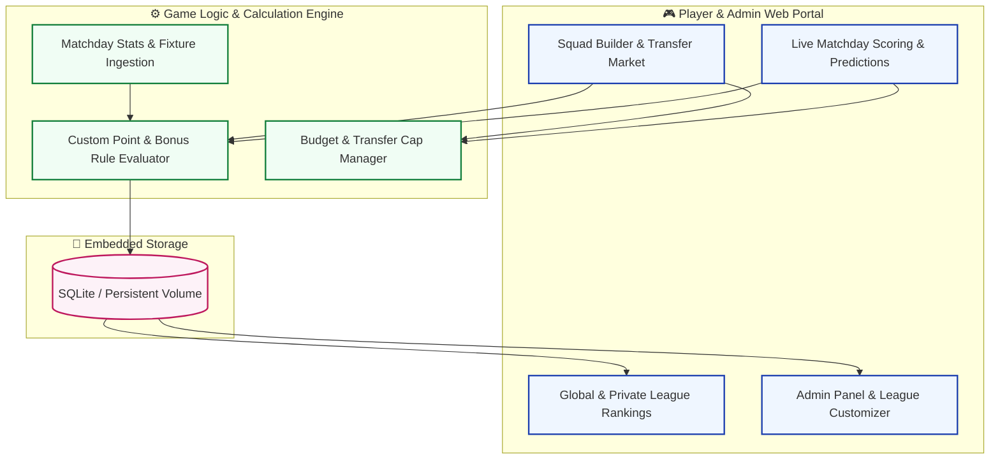

# Fantasy Football Manager — Self-Hosted League & Tournament Engine

<div align="center">

[]()
[](docker/docker-compose.yaml)
[]()
[](LICENSE)

**An open-source, multi-league fantasy sports and predictive match tournament platform.**

</div>

---

## ⚽ Platform Architecture



---

## ✨ Key Features

- **Multi-League Flexibility**: Support for Premier League, Bundesliga, and custom user-defined league plugins.
- **Dynamic Valuation**: Real-time player pricing fluctuations based on form and transfer volume.
- **Match Predictions**: Earn bonus league points by forecasting match outcomes and clean sheets.
- **Modern Responsive UI**: Built-in dark and light themes with responsive mobile squad builders.

---

## 🚀 Deployment via Docker

```bash
# Launch containerized platform
docker-compose -f docker/docker-compose.yaml up -d
```
Access the application on port `3000`.

---

## 📬 Contact

- **Maintainer**: Sayan Bhattacharya ([sayanpm17@gmail.com](mailto:sayanpm17@gmail.com))
